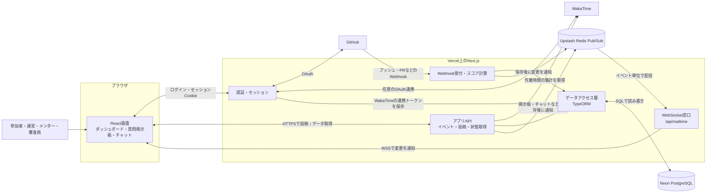
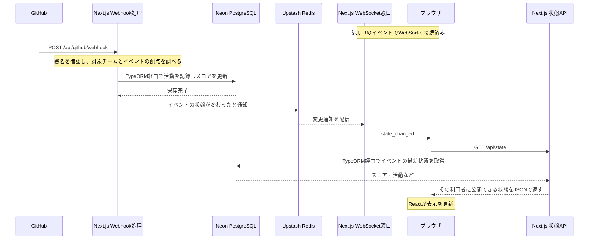

# HackRadarのアーキテクチャ

`main` の `35c2170` を基準に、本番向け構成を示します。画面ごとの入力項目やローカルのデモ構成は省略しています。

## システム構成

- 参加者・運営はGitHub OAuthでログインします。メンターは招待コード・名前・得意分野、審査員は招待コード・名前で参加でき、サーバーがイベントと役割を含むセッションを発行します。
- Neonはデータの保存先です。TypeORMはサーバー側でPostgreSQLへの接続やクエリの実行を扱います。運営がイベントを作ると既存の `events` テーブルに行が追加されます。テーブルの作成はマイグレーションが担当します。
- WakaTime連携ではOAuthで得たトークンをNeonに保存し、作業時間はサーバーがWakaTime APIから取得します。

## GitHubの操作がスコア表示に反映されるまで

ダッシュボードの質問と回答、チャットもHTTPで投稿し、保存後は同じ変更通知を使います。個別DMは `GET /api/direct-messages` を5秒ごとに呼びます。ダッシュボードはWebSocketの購読完了時にも最新状態を取得します。

## 実装をたどる

| 確認する内容 | 実装 |
| --- | --- |
| GitHubのWebhook受付・スコア計算と保存 | [Webhookルート](../app/api/github/webhook/route.ts)、[スコア処理](../lib/store.ts)、[DB処理](../lib/postgres-store.ts) |
| 状態の通知と再取得 | [Redis通知](../lib/realtime.ts)、[WebSocketルート](../app/api/realtime/route.ts)、[画面側の処理](../components/use-hackverse-state.ts)、[状態API](../app/api/state/route.ts) |
| 質問・回答・チャット・DM | [質問API](../app/api/help/route.ts)、[回答API](../app/api/help/replies/route.ts)、[チャットAPI](../app/api/chat/route.ts)、[DM画面](../components/direct-messages.tsx) |
| OAuthと参加時のセッション | [GitHub OAuth](../app/api/auth/github/callback/route.ts)、[メンター参加](../app/api/mentors/join/route.ts)、[審査員参加](../app/api/judges/join/route.ts) |
| WakaTime連携と集計 | [OAuthコールバック](../app/api/auth/wakatime/callback/route.ts)、[集計API](../app/api/wakatime/summary/route.ts)、[連携・集計処理](../lib/wakatime-store.ts) |
| DB接続とスキーマ | [TypeORMの設定](../lib/database.ts)、[マイグレーション](../database/migrations/1730000000000-InitialPostgresSchema.ts) |

## 別のプロジェクトで描くとき

1. 利用者、ブラウザ、サーバー、DB、外部サービスを箱にする。フロントエンドとバックエンドが同じプロジェクトでも、どこで処理が動くかを箱で示す。
2. 代表的な操作を一つ選び、誰が呼ぶか、どこで処理するか、どこに保存するか、誰が結果を読むかを矢印でつなぐ。矢印には「HTTPSで投稿」「SQLで保存」「WebSocketで通知」のように書く。
3. 画面の入力項目はユーザーフローに残す。処理順が大事な機能は、上のスコア反映のようにシーケンス図を添える。
